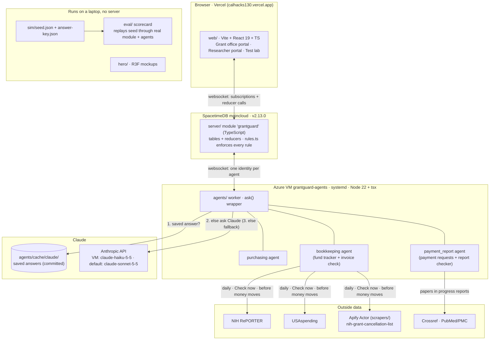
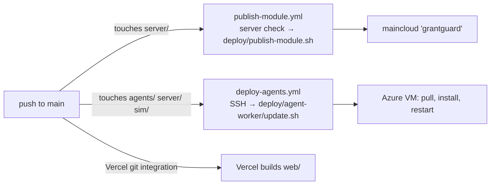
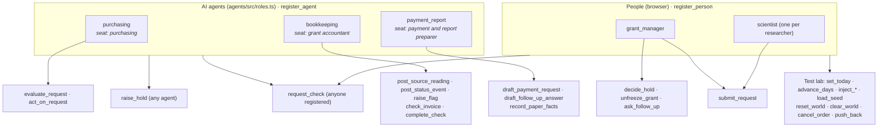
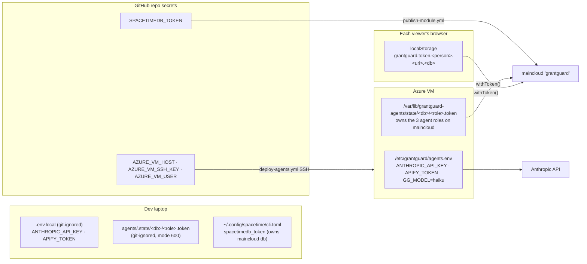

# Architecture: tech stack, identities and where tokens live

Snapshot of `main` on Sat 10/24. Sources: `README.md` (Deploys),
`DECISIONS.md`, `agents/README.md`, `server/src/index.ts`,
`agents/src/identity.ts`, `web/src/data/live.tsx`, `deploy/`,
`.github/workflows/`. If one of those changes, update this page.

## 1. The stack

Key design points:

- **Rules live in the database, not in prompts.** Agents report facts
  (`evaluate_request`, `check_invoice`, `record_paper_facts`,
  `post_status_event`); the module applies `server/src/rules.ts` and raises
  the Inbox item. A buy on a frozen grant fails whatever an agent says.
- **Claude only reads, matches and explains.** Every `ask()` has a
  deterministic fallback, and answers are saved in `agents/cache/claude/`, so
  the demo runs with no key and no network.
- **Offline mode everywhere.** `GG_DB=local` runs the real module in-process
  on `sim/seed.json`; the web app falls back to the same seed ("Offline demo
  data") if maincloud is unreachable.

### Deploy pipeline

## 2. Who is who: identities and what each may call

Every actor is a SpacetimeDB **identity** bound to exactly one role, once
(`register_agent` / `register_person`). The module checks the caller's role
on every reducer, so segregation of duties is enforced by the database.

| Agent | Code | Claude tasks (`ask()` → `agents/cache/claude/<task>-*.json`) |
|---|---|---|
| purchasing | `agents/src/agents/purchasing.ts` | `purchasing.read`, `purchasing.explain` |
| bookkeeping | `agents/src/agents/bookkeeping.ts` (fund tracker), `invoices.ts` | `invoices.note` (the tracker itself is deterministic: `tracker/compare.ts`) |
| payment_report | `agents/src/agents/payment-requests.ts`, `report-checker.ts` | `payment_request.explain`, `payment_request.follow_up`, `report-checker.explain`, `report-checker.correction` |

## 3. Where every token and secret is stored

| Credential | What it is | Stored | Committed? |
|---|---|---|---|
| Agent tokens (×3) | SpacetimeDB identity of `purchasing`, `bookkeeping`, `payment_report`; restarts reuse it, so roles stay bound | VM: `/var/lib/grantguard-agents/state/<db>/<role>.token`. Laptop: `agents/.state/<db>/<role>.token` (`GG_STATE_DIR`). `GG_DB=local`: in memory only | No (git-ignored, outside the checkout on the VM) |
| Person tokens | Identity of the grant manager and each researcher | Browser `localStorage`, key `grantguard.token.<who>.<uri>.<db>`; a stale one is dropped and re-registered | No |
| `ANTHROPIC_API_KEY` | Claude for the agents | Laptop `.env.local`; VM `/etc/grantguard/agents.env` | No |
| `APIFY_TOKEN` | Read/start the cancellation-list Actor | Same as above; sent as a header, never saved | No |
| `SPACETIMEDB_TOKEN` | Owner of the maincloud database; only it can republish | GitHub secret; owner's `~/.config/spacetime/cli.toml` | No |
| `AZURE_VM_SSH_KEY` (+ host, user) | Lets the Action SSH into the VM | GitHub secrets | No |
| Saved Claude answers | Not a secret: deterministic demo replay, keyed by model | `agents/cache/claude/` | **Yes** |
| Saved source answers | Public RePORTER / USAspending / Crossref / PubMed responses | `agents/cache/*.json` | **Yes** |

Notes:

- Tokens are kept **per database** (folder or key includes the db/uri), so a
  local token is never sent to maincloud.
- The VM's agent tokens hold the three agent roles on maincloud. Don't run the
  worker against maincloud from a laptop: it would get new identities and
  `register_agent` refuses a role already taken.
- Every variable name is listed in `.env.example`; values never go in git.
