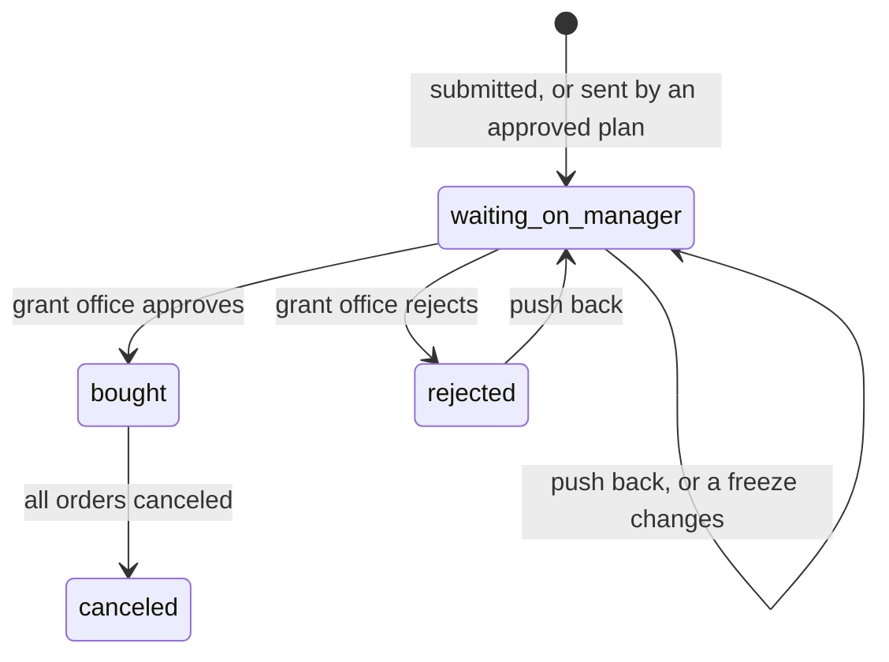

# Purchase request states

Every state a purchase request (`request.state`, `server/src/schema.ts`) can
be in, and who moves it. Read from the code: `submit_request`,
`sendToGrantOffice`, `decide_hold` (`applyDecision`), `push_back` and
`cancel_order` in `server/src/index.ts`. There is no purchasing agent (T108):
nothing is bought without the grant office.

| State | Means | Money | Who acts next |
| --- | --- | --- | --- |
| `waiting_on_manager` | In the grant office's Inbox with the spending rules' verdicts: "Approve …" when every rule passes, "Flagged: approve …" when one fails, with the failed rules as evidence. | Nothing spent. | The grant office: approve or reject, with a reason. |
| `bought` | **Approved**: the order is placed on the grant and the researcher buys it and sends the invoice. | Money promised. Spent once the grant office approves the invoice; then the researcher is reimbursed. | The researcher (buy, send the invoice), then the grant office (approve the invoice). |
| `rejected` | The grant office said no. | Nothing spent. | The researcher may push back. |
| `canceled` | Approved, then every order was canceled. | Promised money released. | Nobody. |
| `submitted`, `blocked`, `rerouted` | Not reached since T108; kept for old rows and deployed clients. | | |

Notes:

- A push back, or a freeze starting or lifting, refreshes the Inbox item with
  what fails now (a request on a frozen grant turns from "Flagged" to
  "Approve" once the payment lands).
- A person's decision stands: approve places the order at once (even on a
  frozen grant or over the card limit, with what fails logged), reject
  refuses.
