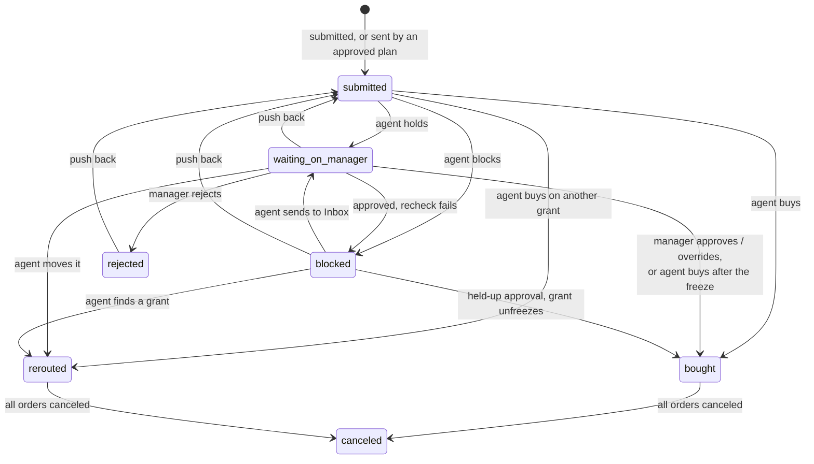

# Purchase request states

Every state a purchase request (`request.state`, `server/src/schema.ts`) can
be in, and who moves it. Read from the code: `act_on_request`, `decide_hold`
(`applyDecision`), `push_back` and `cancel_order` in `server/src/index.ts`,
and the purchasing agent (`agents/src/agents/purchasing.ts`).

| State | Means | Money | Who acts next |
| --- | --- | --- | --- |
| `submitted` | New, or pushed back with new information. | Nothing spent. | The purchasing agent, right away. |
| `waiting_on_manager` | **Held**: an open purchase hold in the grant manager's Inbox says why (freeze, card limit, shared cost without a split, unclear grant, price far above list, ...). | Nothing spent. | The grant manager: approve, reject or override. The agent may still buy it alone if the hold only waited for a freeze. |
| `blocked` | Refused; the explanation cites the failing rule. | Nothing spent. | The agent, if another grant can take it or the grant unfreezes; else the scientist (push back). |
| `bought` | Ordered on the grant asked for. | Orders placed; money promised. | Nobody (an order can still be canceled). |
| `rerouted` | Ordered on a different grant than the one asked for. | Orders placed on that grant. | Nobody (as above). |
| `rejected` | The grant manager said no. | Nothing spent. | The scientist may push back. |
| `canceled` | Bought, then every order was canceled. | Promised money released. | Nobody. |

Notes:

- Not drawn: a push back on a `submitted` request (it stays `submitted`), and
  the agent re-holding a `waiting_on_manager` request with what fails now.
- "Agent buys" means every rule passes, it's under the card limit and the
  price check (T69) finds nothing far above list.
- `bought`, `rerouted`, `rejected` and `canceled` are final for the agent:
  `act_on_request` refuses them. Only a push back reopens a `rejected` one.
- The agent's buy is rechecked by the module at that moment; if the module
  refuses (something changed), the agent holds or blocks on what fails now
  instead of retrying.
- A person's decision stands: once the grant manager has decided, the agent
  never buys that request alone again, except to carry out an approval the
  freeze held up.
- The price check (T69) only applies to the agent buying alone; an approval
  or override is never price-checked.
